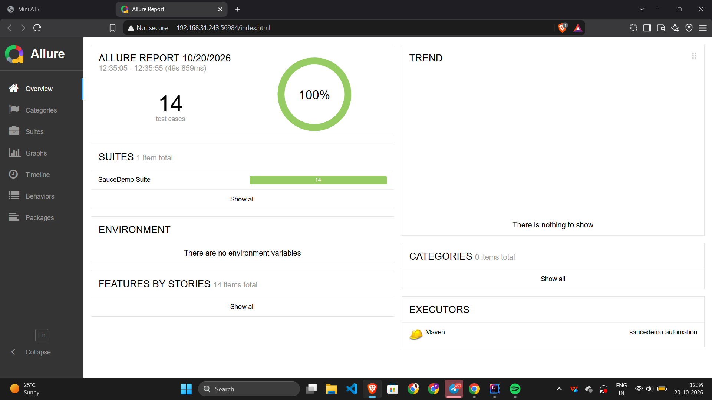

# SauceDemo Test Automation Framework

Selenium WebDriver + Java + TestNG automation framework built with the Page Object Model, tested against [saucedemo.com](https://www.saucedemo.com).

## Tech Stack
Java 21, Selenium 4, TestNG, Maven, Allure Reports, GitHub Actions

## Features
- Page Object Model design
- Explicit waits (no Thread.sleep)
- Data-driven tests using TestNG DataProvider
- Automatic screenshot on failure, attached to the Allure report
- Headless execution and CI through GitHub Actions

## Test Coverage
- Login: valid, invalid, locked-out user, empty fields
- Cart: add single item, add multiple items, remove item
- Checkout: end-to-end purchase, cart item verification, form validation

Total: 14 automated test cases

## Allure Report


## How to Run
```
mvn clean test
mvn allure:serve
```

Headless mode:
```
mvn clean test -Dheadless=true
```

## Project Structure
```
src/main/java/pages        -> Page classes (Login, Inventory, Cart, Checkout)
src/test/java/base         -> BaseTest (driver setup and teardown)
src/test/java/tests        -> Test classes
src/test/java/listeners    -> Failure screenshot listener
testng.xml                 -> Test suite
```
